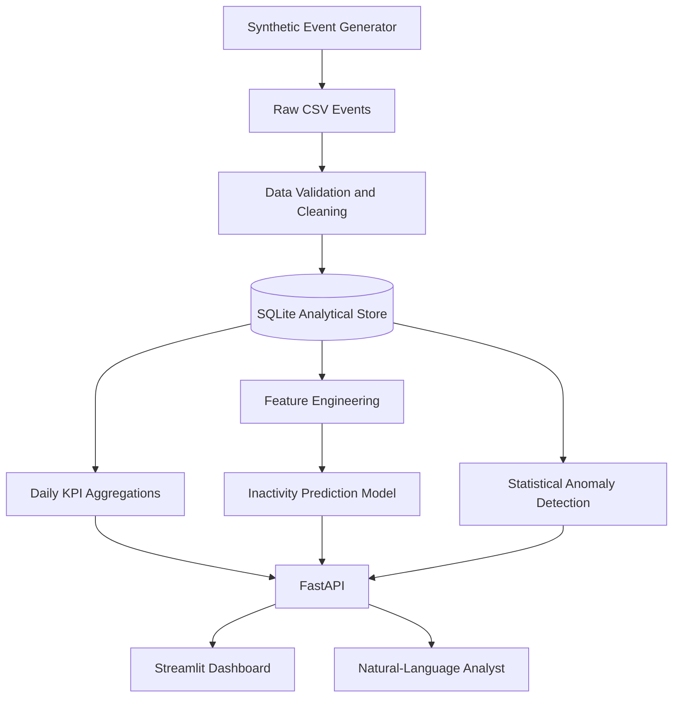

# 🤖 AI-Powered Decision Intelligence Platform

An end-to-end data analytics and machine learning project that turns product-event data into business metrics, user-behavior predictions, anomaly alerts, and evidence-backed answers to natural-language questions.

**Project status:** Working local MVP. The current version includes synthetic event generation, data-quality validation, SQLite analytics, baseline ML, anomaly detection, FastAPI, and a Streamlit dashboard. Kafka, PySpark, dbt, Airflow, and cloud deployment are planned extensions and are not claimed as implemented yet.

---

## 📊 Dashboard Preview

> **Add screenshots here after running the project.** Save screenshots in `screenshots/` and replace the examples below with the real filenames.
>
> Suggested screenshots:
> - `screenshots/overview.png` — KPI overview and daily trends
> - `screenshots/anomalies.png` — anomaly findings
> - `screenshots/ai-analyst.png` — natural-language analyst response

<!-- Uncomment after adding screenshots:


-->

---

## 🎯 What This Project Demonstrates

- **Data engineering:** generates event data, validates records, cleans invalid rows, and loads data into an analytical store.
- **SQL and analytics:** calculates product KPIs and daily/device/country breakdowns.
- **Machine learning:** trains and evaluates a baseline model to predict whether a synthetic user will become inactive in the next seven days.
- **Anomaly detection:** flags unusual daily traffic and latency using an explainable statistical baseline.
- **AI-assisted analysis:** answers a set of natural-language business questions using predefined, parameterized SQL queries; an optional LLM can explain the computed evidence.
- **Application development:** exposes analytics through FastAPI and presents results in a Streamlit dashboard.
- **Software quality:** includes automated tests, repeatable commands, configuration examples, and documentation.

---

## 🔎 Example Business Questions

The platform is designed to help investigate questions such as:

- How many events were processed?
- What was the conversion rate yesterday?
- How does revenue vary by device?
- Which country generated the most events?
- What is the average page latency?
- Were any traffic or latency anomalies detected?
- Which users are predicted to become inactive in the next seven days?

The analyst uses a safe intent router and predefined SQL rather than executing arbitrary, untrusted model-generated SQL.

---

## 🏗️ Architecture



### Technology stack

| Area | Technologies |
|---|---|
| Language and data processing | Python, Pandas, SQL |
| Storage | SQLite |
| Machine learning | scikit-learn |
| API | FastAPI, Uvicorn |
| Dashboard | Streamlit |
| Testing | Pytest |
| Optional AI explanations | OpenAI API |

---

## 📈 Results and Evaluation

Model metrics and data-quality counts are generated by running the pipeline locally. They are intentionally not hard-coded here: the results should come from a reproducible run of the code.

After running the commands below, review:

- `artifacts/model_metrics.json` — model evaluation metrics
- the pipeline output — input, cleaned, rejected, and loaded record counts
- the dashboard and API — KPI and anomaly outputs

**Important:** The data is synthetic. Model performance on this generated dataset is a demonstration of the workflow, not evidence of performance on real users or production data.

---

## 📁 Project Structure

```text
ai-decision-intelligence/
├── data/                       # Generated data and local database (not committed)
├── artifacts/                  # Local model and evaluation outputs (not committed)
├── docs/                       # Architecture and data dictionary
├── src/decision_intelligence/
│   ├── config.py                # Paths and settings
│   ├── generate.py              # Reproducible synthetic event generation
│   ├── quality.py               # Data-quality checks and cleaning
│   ├── storage.py               # SQLite schema and analytical queries
│   ├── pipeline.py              # Generate -> validate -> load workflow
│   ├── features.py               # User-level ML features and labels
│   ├── train.py                  # Model training and evaluation
│   ├── anomalies.py               # Statistical anomaly detection
│   ├── analyst.py                 # Safe natural-language query routing
│   └── api.py                     # FastAPI endpoints
├── tests/                        # Automated tests
├── dashboard.py                  # Streamlit interface
├── pyproject.toml                # Project metadata and dependencies
├── Dockerfile                    # Container build configuration
├── docker-compose.yml             # Local container configuration
├── .env.example                  # Example environment variables
├── .gitignore                    # Excludes generated files and secrets
└── README.md
```

---

## 🚀 Run This Project Locally

### Requirements

- Python 3.10 or newer
- Git
- Internet access for installing dependencies

### 1. Clone the repository

```bash
git clone https://github.com/YOUR_GITHUB_USERNAME/ai-decision-intelligence.git
cd ai-decision-intelligence
```

Replace `YOUR_GITHUB_USERNAME` with your GitHub username. If you downloaded the ZIP instead, extract it and open a terminal in the project folder.

### 2. Create and activate a virtual environment

**macOS / Linux**

```bash
python3 -m venv .venv
source .venv/bin/activate
```

**Windows PowerShell**

```powershell
py -m venv .venv
.venv\Scripts\Activate.ps1
```

### 3. Install dependencies

```bash
python -m pip install --upgrade pip
python -m pip install -e ".[dev]"
```

### 4. Generate events, validate them, and load the database

```bash
python -m decision_intelligence.pipeline --events 100000
```

For a quicker first run, use `--events 10000`. The pipeline creates local data files and reports data-quality counts.

### 5. Train and evaluate the model

```bash
python -m decision_intelligence.train
```

The command prints evaluation metrics and writes a report under `artifacts/`.

### 6. Launch the API

```bash
uvicorn decision_intelligence.api:app --reload
```

Open the interactive API documentation at [http://127.0.0.1:8000/docs](http://127.0.0.1:8000/docs).

### 7. Launch the dashboard

Open a second terminal in the project directory, activate the virtual environment, and run:

```bash
streamlit run dashboard.py
```

Open the local URL printed in the terminal, usually [http://localhost:8501](http://localhost:8501).

### 8. Run tests

```bash
pytest -q
```

---

## 🧪 Data Definitions and Limitations

- **Event:** one recorded synthetic product interaction.
- **Conversion rate:** converted events divided by all events in this simplified demonstration. A production metric should define the eligible session/event denominator precisely.
- **Inactive in seven days:** a synthetic label derived from generated activity, intended for demonstrating a modelling workflow—not for real customer decisions.
- **Anomaly:** a daily traffic or latency value outside a robust median/MAD threshold. This is an interpretable baseline, not a universal anomaly detector.
- **AI analyst:** natural-language questions are mapped to approved query patterns. Optional LLM explanations use computed evidence; the LLM is not given unrestricted database access.

---

## 🛣️ Roadmap

- [ ] Add Kafka producer/consumer for event streaming.
- [ ] Add PySpark transformations and larger-scale processing benchmarks.
- [ ] Add PostgreSQL and dbt staging/mart models with data tests.
- [ ] Orchestrate repeatable jobs with Apache Airflow.
- [ ] Add a fixed AI-analyst evaluation set and measure answer correctness, evidence coverage, latency, and cost.
- [ ] Add CI with GitHub Actions, linting, and test execution.
- [ ] Add real screenshots, benchmark results, and deployment instructions after validating them.

---

## 🔐 Configuration and Data Safety

- Never commit API keys, passwords, `.env` files, generated databases, or private datasets.
- `.env.example` contains placeholders only; add your own local `.env` only if needed.
- All current example event data is synthetic and contains no real customer information.

---

## 👩‍💻 About

Built as a learning and portfolio project to demonstrate an end-to-end workflow across analytics, data quality, machine learning, API development, and AI-assisted investigation.

## 📄 License

MIT — see [`LICENSE`](LICENSE).
