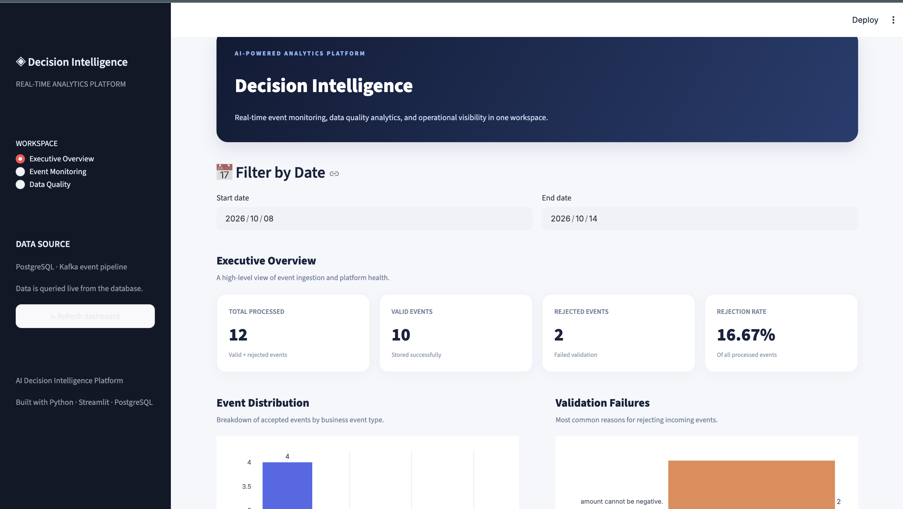
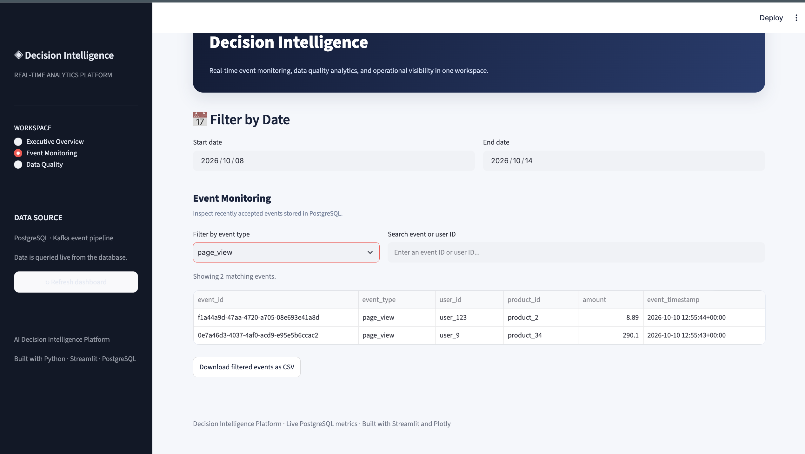
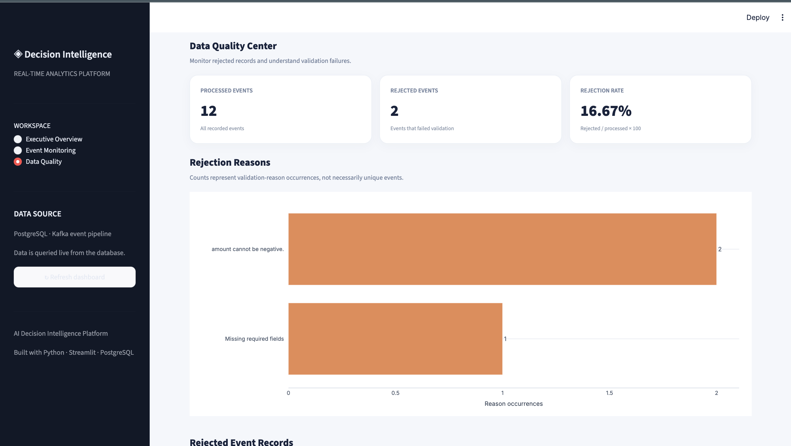
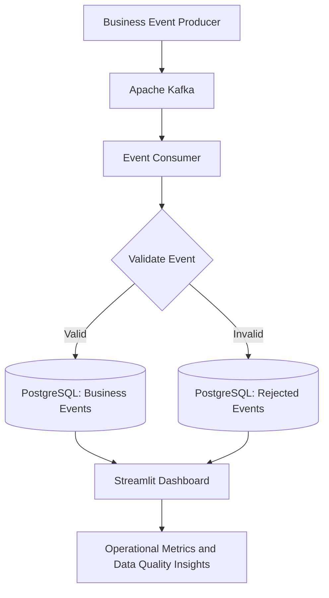

# 🤖 AI-Powered Decision Intelligence Platform

<p align="center">
  <strong>A Data Engineering & Analytics Platform for Real-Time Event Processing, Data Quality Monitoring, and Operational Insights</strong>
</p>

<p align="center">
  
  
  
  
  
  
  
</p>

---

## 📌 Overview

The **AI-Powered Decision Intelligence Platform** is a Python-based data engineering and analytics project designed to process business events, validate incoming data, store accepted and rejected records in PostgreSQL, and visualize operational metrics through an interactive Streamlit dashboard.

The project brings together event processing, database management, data validation, automated testing, and analytics in one modular application.

### Key objectives

- Process structured business events such as page views, signups, cart additions, and purchases.
- Validate incoming data before accepting it into the main database.
- Store rejected events with their validation failure reasons.
- Handle duplicate event IDs safely.
- Monitor operational metrics through an interactive dashboard.
- Support testing of data validation and database operations.

---

## ✨ Key Features

### 1. Business Event Processing
- Structured business event payloads.
- Event types such as `page_view`, `signup`, `add_to_cart`, and `purchase`.
- Unique event identifiers for duplicate detection.
- Producer and consumer modules for the Kafka streaming workflow.

### 2. Data Validation
- Required-field validation.
- Event-type validation.
- Identifier and numeric-value checks.
- Timestamp validation.
- Rejected-event storage with validation reasons.

### 3. PostgreSQL Database
- Persistent storage for accepted events.
- Separate storage for rejected records.
- Database constraints and conflict-aware inserts.
- Duplicate-event handling.

### 4. Interactive Analytics Dashboard
- Processed, valid, and rejected event metrics.
- Rejection-rate monitoring.
- Event distribution charts.
- Validation failure analysis.
- Date and event-type filtering.
- Event and user ID search.
- CSV export for filtered event records.

### 5. Automated Testing
- Unit tests for validation and database operations.
- Tests for rejected-event handling.
- Data quality reporting tests.
- Optional PostgreSQL integration testing.

---

## 📸 Dashboard Preview

The platform includes three dashboard views. The screenshots below are stored in the repository and should appear directly on GitHub when their paths match the files in `docs/images/`.

### 1. Executive Overview

A high-level view of platform activity, event distribution, and operational health.

<p align="center">
  
</p>

**Highlights**
- Total processed events.
- Valid and rejected event counts.
- Rejection rate.
- Event distribution.
- Validation failure summaries.

### 2. Event Monitoring

An interactive view of business events stored in PostgreSQL.

<p align="center">
  
</p>

**Highlights**
- Inspect stored event records.
- Filter by event type and date.
- Search event or user identifiers.
- Review product IDs, amounts, and timestamps.
- Export filtered records to CSV.

### 3. Data Quality Center

A focused view of rejected events and validation issues.

<p align="center">
  
</p>

**Highlights**
- Rejected-event counts.
- Rejection-rate monitoring.
- Common validation failure reasons.
- Rejected-record inspection.

---

## 🏗️ System Architecture

The platform separates event generation, message delivery, validation, persistence, and analytics into individual components.



### Component responsibilities

| Component | Responsibility |
|---|---|
| Producer | Generates business events and publishes messages |
| Apache Kafka | Provides message delivery for the streaming workflow |
| Consumer | Processes incoming events |
| Validation module | Checks event fields and values |
| PostgreSQL | Stores accepted and rejected records |
| Streamlit | Displays analytics and data quality metrics |
| Pytest | Tests application behavior |
| Docker Compose | Supports local container-based development |

The architecture describes the intended streaming workflow. Full end-to-end processing requires the broker, producer, consumer, and database to be configured and running together.

---

## 🛠️ Technology Stack

| Technology | Purpose |
|---|---|
| Python | Application logic and data processing |
| Apache Kafka | Event streaming |
| PostgreSQL | Relational data storage |
| SQL | Database operations and analytics |
| Streamlit | Interactive dashboard |
| Pandas | Tabular data processing |
| Plotly | Interactive visualizations |
| Psycopg | PostgreSQL connectivity |
| python-dotenv | Environment configuration |
| Docker | Containerization |
| Docker Compose | Local service orchestration |
| Pytest | Automated testing |
| Git and GitHub | Version control |

---

## 📂 Project Structure

```text
ai-decision-intelligence/
├── artifacts/
├── data/
├── docs/
│   ├── images/
│   │   ├── executive-overview.png
│   │   ├── event-monitoring.png
│   │   └── data-quality.png
│   ├── ai_evaluation.md
│   ├── architecture.md
│   └── data_dictionary.md
├── scripts/
│   ├── quality_report.py
│   └── test_database.py
├── src/
│   └── decision_intelligence/
│       ├── dashboard/
│       │   └── app.py
│       └── streaming/
│           ├── consumer.py
│           ├── database.py
│           ├── producer.py
│           └── validation.py
├── tests/
├── .env.example
├── .gitignore
├── Dockerfile
├── docker-compose.yml
├── Makefile
├── pyproject.toml
└── README.md
```

Additional files and directories may exist in the repository.

---

## ⚙️ Prerequisites

Before running the project, install:

- Python 3.11 or a compatible version.
- Git.
- Docker Desktop with Docker Compose.
- A PostgreSQL database.
- A Kafka broker for the streaming workflow.

---

## 🚀 Installation and Setup

### Step 1: Clone the repository

```bash
git clone https://github.com/AaradhyaMittal03/ai-decision-intelligence.git
cd ai-decision-intelligence
```

### Step 2: Create a virtual environment

**macOS / Linux**

```bash
python3 -m venv .venv
source .venv/bin/activate
```

**Windows PowerShell**

```powershell
python -m venv .venv
.venv\Scripts\Activate.ps1
```

### Step 3: Install dependencies

```bash
python -m pip install --upgrade pip
pip install -e .
pip install pytest
pip check
```

### Step 4: Configure environment variables

Create your local `.env` file:

```bash
cp .env.example .env
```

Update the database settings in `.env` to match your environment.

Example configuration:

```dotenv
DB_HOST=localhost
DB_PORT=5432
DB_NAME=decision_intelligence
DB_USER=analytics_user
DB_PASSWORD=replace_with_your_local_password
```

These are example values; use your actual local database settings.

**Security:** Never commit your real `.env` file or publish database passwords.

### Step 5: Start the required services

Start the services defined in your Docker Compose configuration:

```bash
docker compose up -d
docker compose ps
```

Check the Compose configuration and ensure PostgreSQL and Kafka are running and reachable before using the database-backed or streaming features.

---

## ▶️ Running the Application

### 1. Check the database connection

From the project root, with the virtual environment activated:

```bash
python scripts/test_database.py
```

The connection test should succeed when PostgreSQL is running and the credentials are correct.

### 2. Start the dashboard

```bash
PYTHONPATH=src streamlit run src/decision_intelligence/dashboard/app.py --server.port 8501
```

Open:

**http://localhost:8501**

The dashboard retrieves event and data quality information from PostgreSQL.

To stop the dashboard, press `Ctrl + C` in the terminal running Streamlit.

### 3. Run the Kafka pipeline

The streaming modules are located in:

```text
src/decision_intelligence/streaming/
├── producer.py
├── consumer.py
├── database.py
└── validation.py
```

Ensure that Kafka and PostgreSQL are running and that the broker address and topic settings match the application configuration.

Use the producer and consumer entry points defined in the source files to start message generation and processing.

---

## 🧹 Data Validation and Quality

Incoming events are validated before being stored as accepted business events.

| Validation check | Example issue |
|---|---|
| Required fields | Missing event ID or timestamp |
| Event type | Unsupported event type |
| Amount | Negative monetary amount |
| Timestamp | Invalid timestamp |
| Field types | Invalid identifier or numeric type |

Accepted events are stored in `business_events`. Rejected events are stored in `rejected_events` with the original payload and validation reasons.

### Duplicate handling

Conflict-aware database inserts help prevent repeated event IDs from being inserted as new records. Rejected-event deduplication depends on the unique index and database logic configured for that table.

---

## 🗄️ Database Design

### `business_events`

Stores accepted business events.

| Column | Description |
|---|---|
| `event_id` | Unique event identifier |
| `event_type` | Type of business event |
| `user_id` | Associated user identifier |
| `product_id` | Associated product identifier |
| `amount` | Non-negative monetary amount |
| `event_timestamp` | Event timestamp |
| `received_at` | Database receipt timestamp |

### `rejected_events`

Stores events that fail validation.

| Column | Description |
|---|---|
| `id` | Database-generated record ID |
| `event_id` | Event identifier, when available |
| `event_payload` | Original event stored as JSONB |
| `rejection_reasons` | Validation failure explanations |
| `rejected_at` | Rejection storage timestamp |

---

## 🧪 Testing

Run the standard test suite:

```bash
pytest -v
```

To enable the PostgreSQL integration test:

```bash
RUN_DB_INTEGRATION_TESTS=1 pytest -v
```

The integration test requires a working database and valid environment configuration.

Test coverage includes event validation, database operations, rejected-event handling, data quality calculations, and integration behavior.

Test counts and results depend on the code version and environment. Run the commands above to verify the current state of the project.

---

## 🛠️ Troubleshooting

### PostgreSQL connection errors

- Ensure PostgreSQL is running.
- Check the `.env` file.
- Verify the host, port, database, username, and password.
- Confirm the database user has the necessary permissions.

```bash
python scripts/test_database.py
```

### Streamlit import errors

Run the dashboard from the repository root:

```bash
PYTHONPATH=src streamlit run src/decision_intelligence/dashboard/app.py --server.port 8501
```

### Kafka connection errors

```bash
docker compose ps
```

Check the broker's listener configuration and ensure the producer and consumer can reach it.

### Dashboard shows no data

Confirm that the database contains records and that the dashboard uses the correct database settings.

### Dashboard screenshots do not appear on GitHub

Check that all three image files are committed and pushed, and that their filenames match the paths in this README exactly.

---

## 🔮 Future Improvements

- End-to-end Kafka integration tests.
- Stronger timestamp and numeric validation.
- Structured logging and operational monitoring.
- Retry and dead-letter handling.
- Additional business KPIs and time-series analytics.
- Database migration management.
- Continuous integration for tests and code quality.
- Cloud deployment and performance testing.

These are potential extensions, not claims that every feature is already implemented.

---

## 🎓 Learning Outcomes

This project demonstrates practical experience with:

- Structured event-processing workflows.
- Kafka producer and consumer concepts.
- Data validation and rejected-record handling.
- PostgreSQL constraints and conflict-aware inserts.
- Interactive analytics with Streamlit and Plotly.
- Automated unit and integration testing.
- Container-based local development.
- Technical documentation for reproducible setup.

---

## 👩‍💻 Author

**Shiwani Verma**

Computer Science Engineering | Software Development | Data Engineering | Analytics

- **GitHub:** [shiwaniverma2060](https://github.com/shiwaniverma2060)
- **Project Repository:** [AI-Powered Decision Intelligence Platform](https://github.com/AaradhyaMittal03/ai-decision-intelligence)

---

## 📄 License

See the [`LICENSE`](LICENSE) file for the applicable license terms.
