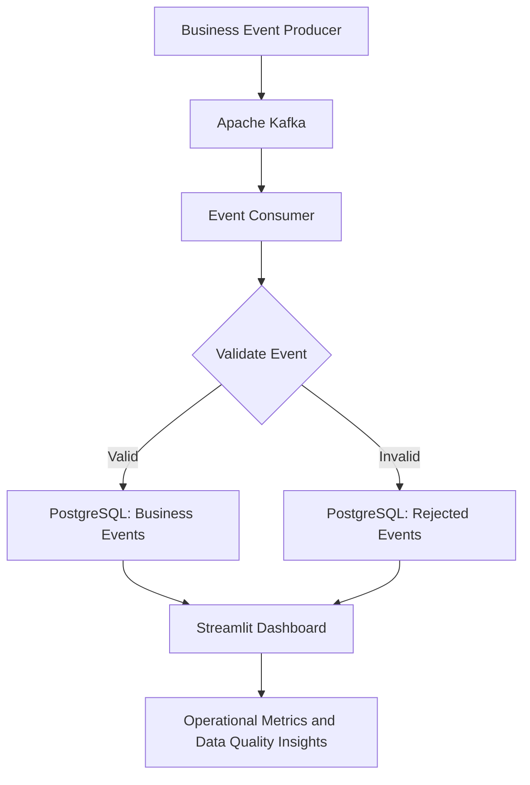

# 🤖 AI-Powered Decision Intelligence Platform

**A data engineering and analytics platform for business event processing, data quality monitoring, and operational decision-making.**

The AI-Powered Decision Intelligence Platform is a Python-based project designed to process business events, validate incoming data, store accepted and rejected records, and present operational metrics through an interactive Streamlit dashboard.

The project combines event-streaming concepts, PostgreSQL storage, data validation, automated testing, and interactive analytics in one workspace.

<p align="center">
  
</p>

<p align="center">
  <b>Python · Apache Kafka · PostgreSQL · Streamlit · Pandas · Plotly · Docker</b>
</p>

---

## 📑 Table of Contents

- [Overview](#-overview)
- [Key Features](#-key-features)
- [Dashboard Preview](#-dashboard-preview)
- [System Architecture](#-system-architecture)
- [Technology Stack](#-technology-stack)
- [Project Structure](#-project-structure)
- [Prerequisites](#-prerequisites)
- [Installation and Setup](#-installation-and-setup)
- [Environment Configuration](#-environment-configuration)
- [Running the Application](#-running-the-application)
- [Data Validation and Quality](#-data-validation-and-quality)
- [Database Design](#-database-design)
- [Testing](#-testing)
- [Troubleshooting](#-troubleshooting)
- [Future Improvements](#-future-improvements)

---

## 🎯 Overview

Modern applications generate business events such as page views, registrations, shopping-cart additions, and purchases. These events become useful only when they can be validated, stored reliably, monitored, and converted into meaningful insights.

This project explores how to build that workflow using a modular data engineering architecture.

The platform focuses on four areas:

1. **Event ingestion:** Generate and process structured business events.
2. **Data validation:** Identify missing fields, invalid event types, negative amounts, and invalid timestamps.
3. **Reliable storage:** Store accepted events and rejected records in PostgreSQL while handling duplicate event IDs.
4. **Operational analytics:** Visualize event activity and data quality metrics through a Streamlit dashboard.

The project is intended as a portfolio demonstration of data engineering, backend development, database operations, and analytics.

## ✨ Key Features

### 1. Business Event Processing

- Generate structured business events.
- Work with event types such as `page_view`, `signup`, `add_to_cart`, and `purchase`.
- Use unique event IDs to identify individual records.
- Prepare events for processing through a Kafka producer and consumer workflow.

### 2. Event Validation

The validation module checks incoming events for issues such as:

- Missing required fields.
- Unsupported event types.
- Invalid identifiers or field types.
- Negative or invalid monetary amounts.
- Invalid timestamps.

Invalid records can be routed to rejected-event storage with explanations of the validation failures.

### 3. PostgreSQL Integration

- Store accepted business events in PostgreSQL.
- Store rejected event payloads and validation reasons.
- Use database constraints to protect data integrity.
- Handle duplicate event IDs using conflict-aware inserts.
- Use database operations that support repeatable processing.

### 4. Interactive Analytics Dashboard

- Monitor total processed events.
- Compare valid and rejected events.
- Track rejection rates.
- Explore event distribution.
- Inspect validation failure reasons.
- Filter events by date and event type.
- Search using event or user IDs.
- Download filtered event records as CSV.

### 5. Automated Testing

The project includes unit tests for event validation, database operations, rejected-event handling, data quality reporting, and related functionality.

A PostgreSQL integration test can also verify event insertion and duplicate handling against a real database.

---

## 📸 Dashboard Preview

The dashboard contains three main views designed to make event activity and data quality easier to understand.

### 1. Executive Overview

Provides a high-level view of platform health, including processed events, accepted and rejected records, rejection rate, event distribution, and validation failures.

   

**What it demonstrates:**
- Business and operational KPIs.
- Event distribution across event types.
- Validation failure summaries.
- Date-based filtering.

### 2. Event Monitoring

Provides an interactive view of accepted business events stored in PostgreSQL.

   

**What it demonstrates:**
- Filtering by event type.
- Searching event and user IDs.
- Inspecting event IDs, product IDs, amounts, and timestamps.
- Exporting filtered records to CSV.

### 3. Data Quality

Provides visibility into rejected events and the reasons incoming records failed validation.

   

**What it demonstrates:**
- Processed and rejected event counts.
- Rejection-rate monitoring.
- Validation failure analysis.
- Rejected-event record inspection.

---

## 🏗️ System Architecture

The project separates event generation, validation, storage, and analytics into distinct components.

### High-level data flow



### Component responsibilities

| Component | Responsibility |
|---|---|
| Producer | Generates structured business events and publishes messages. |
| Kafka | Provides a messaging layer for event delivery. |
| Consumer | Reads incoming messages and coordinates validation and persistence. |
| Validation module | Checks required fields, event types, amounts, and timestamps. |
| PostgreSQL | Stores accepted events and rejected-event records. |
| Streamlit | Presents event activity and data quality metrics. |
| Pytest | Tests validation rules, database behavior, and reporting logic. |
| Docker Compose | Defines container services for local development, including Kafka. |

The diagram represents the intended event-processing flow. Actual end-to-end Kafka behavior depends on configuring and running the producer, broker, consumer, and database together.

---

## 🛠️ Technology Stack

| Technology | Purpose |
|---|---|
| Python | Core application and data processing |
| Apache Kafka | Event streaming and message delivery |
| PostgreSQL | Relational database and persistent storage |
| SQL | Data retrieval, insertion, and analytics |
| Streamlit | Interactive dashboard |
| Pandas | Tabular data processing |
| Plotly | Interactive charts and visualizations |
| Psycopg | PostgreSQL connectivity |
| python-dotenv | Environment variable management |
| Docker | Containerization |
| Docker Compose | Local service orchestration |
| Pytest | Automated testing |
| Git and GitHub | Version control and project hosting |

---

## 📂 Project Structure

The repository contains the following main components. Some additional files may exist in the project.

```text
ai-decision-intelligence/
│
├── .github/                         # GitHub configuration
├── artifacts/                       # Generated project artifacts
├── data/                            # Project data files
├── docs/
│   ├── images/
│   │   ├── executive-overview.png
│   │   ├── event-monitoring.png
│   │   └── data-quality.png
│   ├── ai_evaluation.md
│   ├── architecture.md
│   └── data_dictionary.md
│
├── scripts/
│   ├── quality_report.py
│   └── test_database.py
│
├── src/
│   ├── ai_decision_intelligence/
│   │   └── streaming/
│   └── decision_intelligence/
│       ├── dashboard/
│       │   └── app.py
│       └── streaming/
│           ├── consumer.py
│           ├── database.py
│           ├── producer.py
│           └── validation.py
│
├── tests/
│   ├── test_analyst.py
│   ├── test_generator.py
│   ├── test_quality.py
│   ├── test_quality_report.py
│   ├── test_rejected_events.py
│   ├── test_streaming_database.py
│   ├── test_streaming_database_integration.py
│   └── test_streaming_validation.py
│
├── .env.example
├── .gitignore
├── Dockerfile
├── docker-compose.yml
├── Makefile
├── pyproject.toml
└── README.md
```

**Important files:**

- `producer.py` — creates and publishes business events.
- `consumer.py` — consumes events and coordinates validation and storage.
- `validation.py` — contains event validation rules.
- `database.py` — implements PostgreSQL connection and persistence operations.
- `app.py` — provides the Streamlit dashboard.
- `quality_report.py` — generates a data quality report.
- `test_database.py` — helps verify the database connection and table setup.
- `docker-compose.yml` — defines local container services.
- `pyproject.toml` — defines project metadata, dependencies, and tool configuration.

---

## ⚙️ Prerequisites

Install the following before running the project:

- Python 3.11 or a compatible Python version.
- Git.
- Docker Desktop with Docker Compose.
- PostgreSQL, accessible through a local installation or container.
- A terminal and a code editor such as VS Code.

A Kafka broker is needed for the streaming workflow. PostgreSQL must be accessible for the database-backed dashboard and integration tests.

---

## 🚀 Installation and Setup

### Step 1: Clone the repository

```bash
git clone https://github.com/AaradhyaMittal03/ai-decision-intelligence.git
cd ai-decision-intelligence
```

### Step 2: Create a virtual environment

On macOS or Linux:

```bash
python3 -m venv .venv
source .venv/bin/activate
```

On Windows PowerShell:

```powershell
python -m venv .venv
.venv\Scripts\Activate.ps1
```

### Step 3: Install dependencies

Upgrade pip and install the project:

```bash
python -m pip install --upgrade pip
pip install -e .
```

Install the testing dependency if it is not already installed:

```bash
pip install pytest
```

Verify installed dependencies:

```bash
pip check
```

### Step 4: Configure environment variables

Create a local `.env` file in the project root using `.env.example` as a reference.

```bash
cp .env.example .env
```

Edit `.env` with your local PostgreSQL connection details.

**Never commit your real `.env` file or expose database passwords in your repository.**

### Step 5: Start the required services

Start the Kafka service defined in Docker Compose:

```bash
docker compose up -d kafka
```

Check the service status:

```bash
docker compose ps
```

Make sure PostgreSQL is also running and reachable using the credentials configured in `.env`.

The supplied Compose configuration defines Kafka; use the PostgreSQL setup appropriate to your local environment.

---

## 🔐 Environment Configuration

The database module reads these environment variables:

| Variable | Purpose | Example for local development |
|---|---|---|
| `DB_HOST` | PostgreSQL host | `localhost` |
| `DB_PORT` | PostgreSQL port | `5432` |
| `DB_NAME` | Database name | `decision_intelligence` |
| `DB_USER` | Database user | `analytics_user` |
| `DB_PASSWORD` | Database password | Your local password |

Example `.env` configuration:

```dotenv
DB_HOST=localhost
DB_PORT=5432
DB_NAME=decision_intelligence
DB_USER=analytics_user
DB_PASSWORD=replace_with_your_local_password
```

These are example local-development settings. Update them to match your PostgreSQL configuration.

The Kafka producer also has a broker address configured in its code. Ensure that the producer and consumer use a broker address reachable from where they run.

---

## ▶️ Running the Application

### 1. Verify PostgreSQL connectivity

With your virtual environment activated and `.env` configured, run:

```bash
python scripts/test_database.py
```

The connection check should succeed if PostgreSQL is running, the credentials are correct, and the required database is available.

### 2. Start the dashboard

From the project root, run:

```bash
PYTHONPATH=src streamlit run src/decision_intelligence/dashboard/app.py --server.port 8501
```

Open the dashboard in your browser:

**http://localhost:8501**

The dashboard queries PostgreSQL for event and data quality metrics.

To stop Streamlit, press `Ctrl + C` in the terminal running the application.

### 3. Run the streaming producer and consumer

The streaming components are located in:

```text
src/decision_intelligence/streaming/
├── producer.py
├── consumer.py
├── database.py
└── validation.py
```

Before running the pipeline, ensure Kafka and PostgreSQL are running and the topic and broker configuration match the application settings.

The producer publishes generated business events. The consumer processes messages, validates event payloads, and stores accepted or rejected records.

Use the entry-point instructions defined in the respective modules. If you run the modules directly, first verify that their `__main__` entry points are present and that their broker configuration is correct.

---

## 🧹 Data Validation and Quality

Data quality is an important part of the event-processing workflow.

The validation module checks incoming event payloads before they are accepted into the main business-events table.

Examples of validation issues include:

| Validation check | Example issue |
|---|---|
| Required fields | Missing event ID or timestamp |
| Event type | An unsupported event type |
| Amount | A negative monetary amount |
| Timestamp | An invalid timestamp value |
| Field types | An identifier or amount with an invalid type |

Accepted records are stored in `business_events`. Rejected records are stored in `rejected_events`, along with their original payload and validation reasons.

The dashboard summarizes these results to help identify common data quality issues.

### Duplicate handling

The database uses conflict-aware inserts for event IDs. This allows the application to detect whether an event was inserted or whether an existing event ID was encountered again.

Rejected-event storage also uses a unique index for usable, non-null event IDs to prevent duplicate rejected records from being inserted for the same ID.

---

## 🗄️ Database Design

### `business_events`

Stores accepted business events.

| Column | Description |
|---|---|
| `event_id` | Unique event identifier and primary key |
| `event_type` | Type of business event |
| `user_id` | Identifier of the user associated with the event |
| `product_id` | Identifier of the associated product |
| `amount` | Non-negative monetary amount |
| `event_timestamp` | Timestamp associated with the event |
| `received_at` | Database receipt timestamp |

### `rejected_events`

Stores records that fail validation.

| Column | Description |
|---|---|
| `id` | Database-generated primary key |
| `event_id` | Usable event identifier, when available |
| `event_payload` | Original rejected event stored as JSONB |
| `rejection_reasons` | List of validation errors |
| `rejected_at` | Timestamp when the rejected record was stored |

The rejected-event table supports records without a usable event ID. When an ID is present, a partial unique index enforces uniqueness for non-null IDs.

---

## 🧪 Testing

The project uses Pytest for automated testing.

### Run the standard test suite

```bash
pytest -v
```

### Run the suite with PostgreSQL integration testing enabled

```bash
RUN_DB_INTEGRATION_TESTS=1 pytest -v
```

The second command enables the integration test that verifies event insertion and duplicate handling against PostgreSQL. Ensure the database is running and configured correctly before executing it.

### Test coverage areas

- Event validation rules.
- Missing and invalid event fields.
- Database insertion and duplicate handling.
- Rejected-event storage.
- Data quality calculations.
- Analyst and generator behavior.
- PostgreSQL integration.

**Verified project result:** The complete test suite returned **18 passed in 1.10 seconds**, including the PostgreSQL integration test, in the development environment.

Test results may differ on another machine depending on the environment, dependencies, and database configuration.

---

## 🛠️ Troubleshooting

### PostgreSQL connection errors

Check that:

- PostgreSQL is running.
- `.env` exists in the project root.
- The database name, user, password, host, and port are correct.
- The database user has the required permissions.

Run the database check again:

```bash
python scripts/test_database.py
```

### Streamlit cannot import project modules

Run the dashboard from the repository root using the documented command:

```bash
PYTHONPATH=src streamlit run src/decision_intelligence/dashboard/app.py --server.port 8501
```

Ensure the virtual environment is activated.

### Kafka connection errors

Check the broker status:

```bash
docker compose ps
```

Review the Kafka listener configuration and confirm that the address used by the producer and consumer is reachable from their execution environment.

### Dashboard shows no data

Confirm that PostgreSQL contains event records and that the database connection settings match those used by the application.

### Integration tests fail

Ensure PostgreSQL is available, `.env` is correctly configured, and the test database can create or access the required tables.

---

## 🔮 Future Improvements

Potential improvements for future iterations include:

- End-to-end Kafka integration tests covering producer-to-consumer processing.
- Stronger timestamp and numeric validation, including edge cases.
- Improved observability with structured logs and operational metrics.
- Configurable retry and dead-letter handling.
- Additional business KPIs and time-series analytics.
- More extensive database migration management.
- CI automation for tests and code quality checks.
- Deployment to a cloud environment.
- Expanded architecture documentation and performance testing.

These are potential extensions rather than claims that every item is already implemented.

---

## 🎓 Learning Outcomes

This project brings together practical concepts from data engineering, backend development, and analytics:

- Designing structured event-processing workflows.
- Working with Kafka producers and consumers.
- Validating incoming data and handling rejected records.
- Using PostgreSQL constraints and conflict-aware inserts.
- Building interactive analytics dashboards with Streamlit and Plotly.
- Writing automated unit and integration tests.
- Configuring local services using Docker Compose.
- Documenting software so other developers can reproduce the setup.

---

## 👩‍💻 Author

**Shiwani Verma**

Computer Science Engineering | Software Development | Data Engineering | Analytics

- GitHub: [@shiwaniverma2060](https://github.com/shiwaniverma2060)
- Project repository: [AI-Powered Decision Intelligence Platform](https://github.com/AaradhyaMittal03/ai-decision-intelligence)

---

## 📄 License

This project includes a `LICENSE` file. Refer to that file for the applicable license terms.
